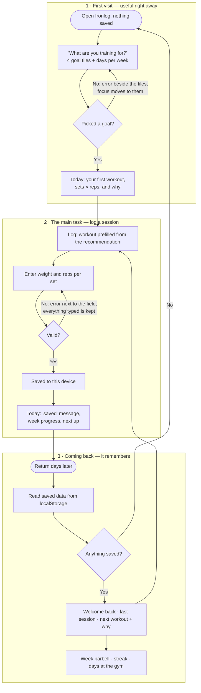

# Ironlog

**A gym coach that lives in your browser.** Tell it your goal and how many days
a week you can train; it hands you today's workout, remembers what you lift, and
every time you come back it tells you what to train next — and why.

Built for MPCS 51238 *Design, Build, Ship* — Assignment 3, Patterns & Flows.
Next.js + Tailwind, no database, no accounts, no external APIs. Everything is
saved in the browser with `localStorage`.

- **Live:** _add the Vercel URL here_
- **Who it's for:** someone who lifts a few days a week and keeps losing track of
  what they did last time and what they should do next.
- **What brings them back:** a workout that is already chosen for them, *with a
  reason*; a barbell that fills up plate by plate each week; a streak of weeks
  they hit their target; and "last time → try this" numbers that make the next
  session obvious.

## The flow

> I pick a goal and my days → I see today's workout right away → I log what I
> lifted → I come back later, and it remembers me and tells me what to train next.



The same diagrams, plus the screen/state/error table and what was cut, are in
[`flows.md`](./flows.md).

## Pages

| Route | Step | What it does |
|---|---|---|
| `/` | First visit **and** coming back | No data → goal + days picker → today's workout. Has data → "Welcome back", the recommended workout and its reason, the week's barbell, streak. |
| `/log` | Main task | One-column form prefilled with today's recommendation; validation errors beside each field; last-time hints and a "Use suggestion" button. |
| `/progress` | Reason to return | Weekly barbell, month calendar of training days, every lift with its best and last set (PR tags), full session history with delete. |
| `/plan` | Control | Change goal, days or units (saved weights convert); see the weekly rotation; reset everything (with confirm). |

Shared navigation (a thumb-height tab bar on phones, header links on desktop)
marks the current page with `aria-current` and a bar; `/log` also has a
"← Back to Today" link.

## How it decides what you do next

Plain rules, not AI — so the "why" on screen is always true (`lib/recommend.ts`,
tested):

1. Your goal and days per week pick a weekly rotation (e.g. *Build muscle, 4 days
   → Upper · Lower · Upper · Lower*).
2. For each workout type in the rotation, it finds how long its muscles have
   rested, using the exercises you actually logged.
3. It recommends the most rested workout; ties follow the rotation. If nothing
   has had two days off, it suggests a recovery day instead.
4. Sets and reps come from your goal (strength = heavy 3–5s, muscle = 6–15, …),
   and each lift gets a progressive-overload suggestion: add a rep, then add
   weight once you hit the top of the range.

Skipping a day never breaks the plan — the next visit just picks what's most
rested.

## Onboarding research

Three subagents studied how **Fitbod**, **Strong**, and **Nike Training Club**
welcome new people (public sources only — they couldn't install the apps, and
where sources conflicted or couldn't be opened, they said so). Full notes:
[`docs/research.md`](./docs/research.md).

| What we found | What we did |
|---|---|
| Fitbod: 14 onboarding steps and a paywall before the first workout. Nike: a full account before any value. Strong: sign-up first, and an empty first screen. | **No account at all**, and only **two questions** (goal, days) before a real workout. |
| Fitbod explains its picks through muscle recovery; Strong's logger is clean with details one tap away. | A visible **"Why: …"** line on the recommendation; fast set-by-set logging with last-time hints. |
| Fitbod and Nike use *weekly* targets and streaks. | A weekly target and a streak of **weeks** — a rest day never breaks it. |

## Design: "Iron"

A gym should look like a gym: near-black concrete, caution-tape rules, heavy
condensed uppercase type (Big Shoulders Display) with Barlow for reading, and a
barbell that loads plates as you train.

- **Safety yellow is reserved for the one primary action on a screen** and the
  keyboard focus ring. Everything else is white, gray, or outlined.
- **Shared components** (`components/`): `Button`, `Field` (label + hint + error +
  control), `Input`/`Select`, `Banner`, `ConfirmDialog` (native `<dialog>`),
  the goal/days/unit pickers, `WeekBar`, `Calendar`, and the nav — used on every
  page, no per-page restyling.
- A stencil face was tried for numerals and **removed**: "4 × 6–10" looked like
  "ᒧ × b–10", and for something read between sets, legibility beats style.

### Forms and errors

One column of fields, a real `<label>` on every control (set rows use visually
hidden labels like "Barbell bench press, set 2, reps" under visible
"Weight / Reps" column headings, like a logbook). Errors sit directly under the
field and say what to do — *"Enter how many reps you did at this weight."* —
never "Invalid input". On any error the form **keeps everything typed**, marks
the field `aria-invalid`, ties the message with `aria-describedby`, and moves
focus to the first problem.

### Remembering you

`localStorage` key `ironlog:v1` holds your plan and sessions. Loading validates
every field, so corrupt or hand-edited data can't crash the app — unreadable
parts are dropped and a notice says so. If the browser blocks storage (private
mode), the app keeps working in memory and tells you it won't survive the tab.
Other tabs stay in sync through the `storage` event. Clearing site data erases
everything; the Plan page says so plainly.

## Accessibility

- **Keyboard:** every flow works without a mouse — tested by a script that does
  first visit → log → save using only Tab, arrows, Space and Enter. Goal/day/unit
  choices are real radio inputs (arrow keys work); the dialog is a native
  `<dialog>` (focus trapped, Escape closes, focus returns); skip link on every page.
- **Labels:** every field has a real label; icon-only controls have accessible
  names; "Skip exercise" keeps its visible text in its accessible name.
- **Contrast** was *computed*, not eyeballed (WCAG ratios, foreground on its
  actual background):

  | Pair | Ratio | Needs |
  |---|---|---|
  | Text on background / surface / raised | 17.8 / 16.4 / 14.6 : 1 | 4.5 |
  | Muted text on background / surface / raised | 8.1 / 7.5 / 6.7 : 1 | 4.5 |
  | Ink on the yellow button | 13.8 : 1 | 4.5 |
  | Yellow focus ring on background / surface | 13.8 / 12.7 : 1 | 3 |
  | Error text on surface | 7.8 : 1 | 4.5 |
  | Input border on surface | 5.2 : 1 | 3 |

- **Automated audit:** axe-core (WCAG 2.0/2.1 A + AA + best practices) across 16
  screens and states — first visit, first visit with an error, returning, log form
  and log form with errors, progress, progress with a dialog open, plan — at 390px
  and 1440px: no violations. (It first caught a real label-mismatch on the "Skip
  exercise" buttons, which was fixed.)
- Status is never color alone: errors carry a "!" mark and words, read/saved
  states carry a ✓ and text; reduced-motion users get no animation.

## Tech and decisions

Next.js (App Router) + Tailwind, TypeScript. No database, accounts, backend, or
external APIs; no extra runtime dependencies. Tests use Node's built-in runner.
Who decided what — the author's choices versus the agent's proposals — is recorded in
[`docs/decisions.md`](./docs/decisions.md).

```bash
npm install
npm run dev      # http://localhost:3000
npm run build
npm run lint
npm test         # 30 tests: recommendations, streaks, PRs, validation, storage
```

Browser checks (Playwright, not part of the build) live in
[`scripts/verify/`](./scripts/verify/README.md).

## First-run check

_Added after deployment — the agent's usability feedback as a brand-new user, and
what changed because of it._

## Known limitations

- Data lives only in one browser on one device (that's the assignment's scope;
  accounts and sync come next week). Clearing site data erases it.
- The streak applies the *current* weekly target to past weeks.
- Exercise suggestions are general guidance, not medical advice.
- Checks here are agent-driven (scripts and an agent playing a new user); they
  are not a substitute for watching real people use it.
