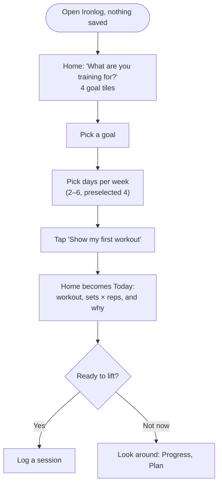
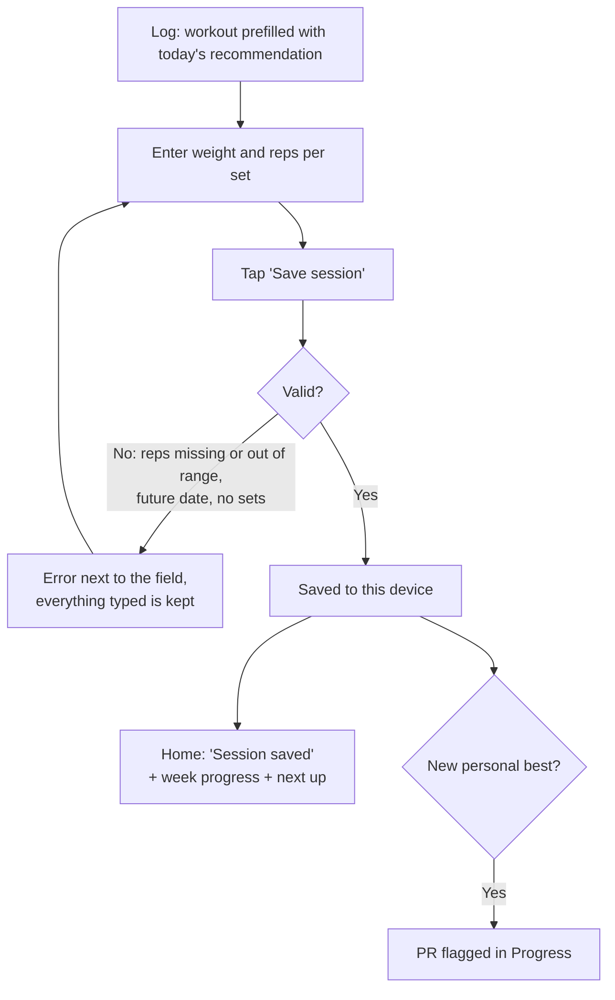
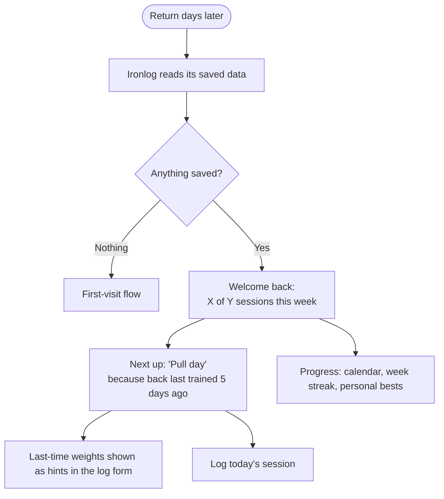

# Flows

**The main task, as a sentence:**
I pick a goal and my training days → I see today's workout right away → I log
what I lifted → I come back later, and the app remembers me and tells me what
to train next.

## The three flows

### 1. First visit — useful right away

No sign-up, no tour, no empty screen — two taps from a cold start to a real
workout.

### 2. The main task — log a session (the form)

### 3. Coming back — it remembers

## Screens and states (what the agent proposed, and what we kept)

| Screen | Route | States | Errors |
|---|---|---|---|
| Today | `/` | loading, first visit (goal picker), returning, trained today, week target hit | storage unreadable → start fresh, say so |
| Log | `/log` | prefilled, saving, saved | reps required (1–100), weight 0–1000, date not in the future, at least one set |
| Progress | `/progress` | has sessions, plan-only (no sessions yet — never blank) | — |
| Plan | `/plan` | goal, days, units, backup, reset | confirm before reset |

Considered and **cut** for simplicity: accounts and sync (next week's topic),
equipment and experience questions on first visit, editing past sessions
(delete only), rest timer, exercise videos, per-set RPE.
